

# GrowthLab

### Self Development for Job Seeker

Multimedia pembelajaran interaktif berbasis website untuk mengembangkan *soft skill* peserta didik SMK kelas XII dan lulusan baru (*fresh graduate*) dalam menghadapi proses mencari kerja.

**[Buka GrowthLab](https://akirasakamiyo.github.io/GrowthLab/)**

Kelompok 8 · Pengembangan Multimedia Pendidikan · Program Studi Teknologi Pendidikan · Fakultas Ilmu Pendidikan · Universitas Negeri Jakarta

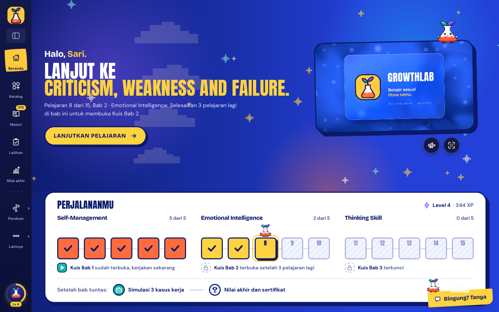

## Identitas Produk

| Komponen | Keterangan |
|---|---|
| Nama produk | GrowthLab: Self Development for Job Seeker |
| Judul pengembangan | Pengembangan Multimedia Interaktif Berbasis Website untuk Meningkatkan Soft Skill Fresh Graduate saat Mencari Kerja |
| Jenis media | Multimedia interaktif berbasis website |
| Sasaran | Peserta didik SMK kelas XII dan lulusan baru |
| Topik | Pengembangan diri (*soft skill*) |
| Mata kuliah | Pengembangan Multimedia Pendidikan |
| Dosen pengampu | Kunto Imbar Nursetyo, S.Pd., M.Pd. |
| Program studi | Teknologi Pendidikan, Fakultas Ilmu Pendidikan, Universitas Negeri Jakarta |
| Tim pengembang | Kelompok 8: Rifa Haqi Putra Wibowo (1101624089) dan Thumpal Alvin (1101624069) |
| Model pengembangan | Hannafin dan Peck |
| Alamat produk | https://akirasakamiyo.github.io/GrowthLab/ |

## Latar Belakang

Lulusan SMK memiliki tingkat pengangguran terbuka tertinggi dibandingkan jenjang pendidikan lain (BPS, Februari 2025: 8 persen). Selain keterampilan teknis, dunia kerja menuntut kemampuan mengelola diri, mengelola emosi, dan berpikir jernih dalam mengambil keputusan. GrowthLab dikembangkan untuk melatih ketiga kemampuan tersebut melalui materi yang ringkas, latihan interaktif, dan simulasi kasus dunia kerja.

## Tujuan Pembelajaran

Setelah menyelesaikan GrowthLab, peserta didik diharapkan mampu menerapkan *soft skill* pengelolaan diri, kecerdasan emosional, dan keterampilan berpikir dalam menghadapi proses mencari kerja dan dunia kerja. Tujuan umum tersebut dijabarkan menjadi 15 tujuan pembelajaran khusus berformat ABCD (*Audience, Behavior, Condition, Degree*), satu untuk setiap pelajaran. Seluruh tujuan, beserta materi dan alat evaluasi yang mengukurnya, dapat dilihat pada halaman **Tujuan belajar** di dalam produk.

## Ruang Lingkup Materi

| Bab | Topik | Pelajaran |
|---|---|---|
| 1 | Self-Management | Recognise Your Strengths; Thoughts, Feelings, & What You Do; Change Your Thinking; Problem Solving; Keeping Well |
| 2 | Emotional Intelligence | Emotional and Social Awareness; Facing Stress and Burnout; Criticism, Weakness and Failure; Happiness in Life; Communicate with Empathy |
| 3 | Thinking Skill | System Thinking; Critical Thinking; Strategic Thinking; Reflective Thinking; Creative Thinking |

Judul pelajaran mengikuti Jabaran Materi. Rujukan setiap pelajaran (buku, jurnal, dan artikel) tercantum pada halaman **Referensi**.

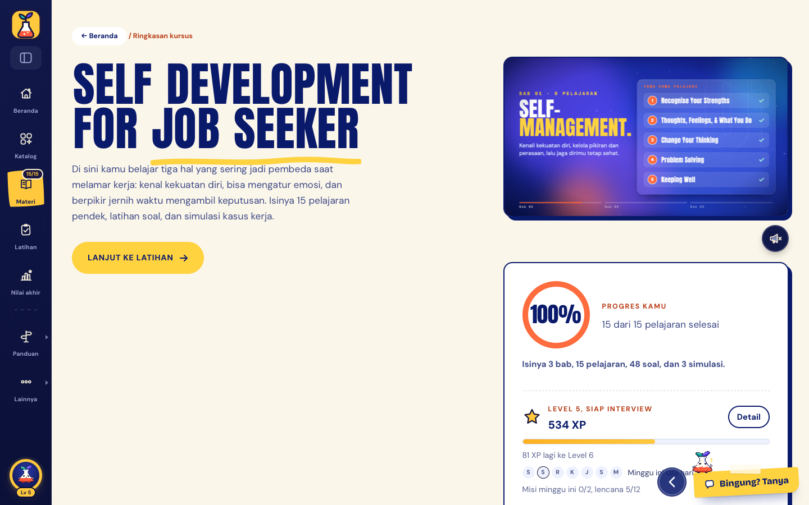

## Komponen Produk

### 1. Beranda dan dashboard peserta

Pengunjung baru disambut dengan beranda pengenalan dan video promo. Setelah peserta menyelesaikan minimal satu pelajaran, beranda berubah menjadi dashboard yang menampilkan pelajaran berikutnya, progres 15 pelajaran per bab, status kuis setiap bab, perolehan XP, serta tahap simulasi dan nilai akhir. Seluruh informasi tersebut termuat dalam satu layar.

### 2. Materi pembelajaran

Setiap pelajaran terdiri atas uraian materi, konsep penting, diagram, contoh kasus, aktivitas mandiri "Coba sendiri", ringkasan, dan **uji pemahaman** (4 soal per pelajaran, total 60 soal) yang berupa studi kasus, soal dua tingkat (jawaban dan alasan), serta soal uraian singkat. Sesuai masukan dosen, materi ditampilkan terlebih dahulu sebelum aktivitas dan kuis. Pelajaran dibuka secara berurutan.

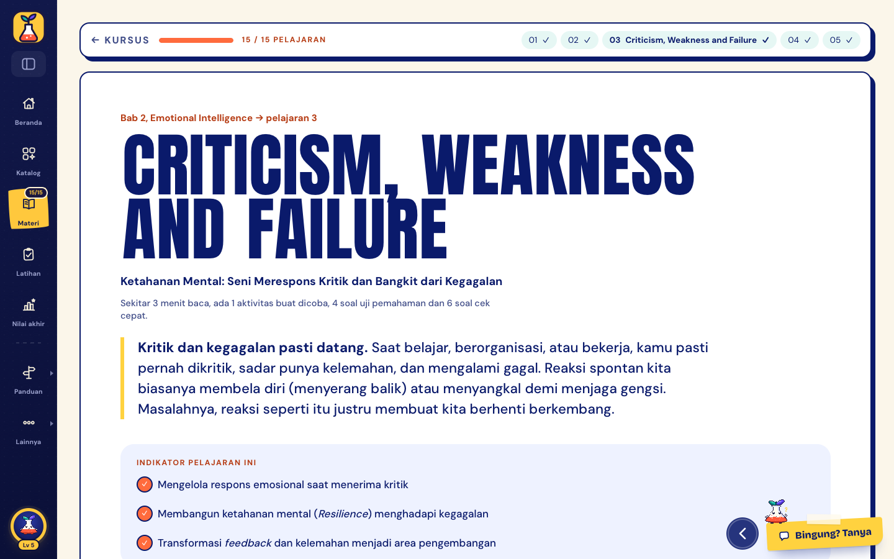

### 3. Latihan

- **Kuis pilihan ganda** sebanyak 48 soal, dikerjakan per bab atau gabungan, dengan poin, bonus jawaban beruntun, dan petunjuk bertahap.
- **Drag and drop** sebanyak 8 set, dapat dikerjakan dengan tetikus, layar sentuh, atau papan ketik.
- Latihan setiap bab baru terbuka setelah seluruh pelajaran pada bab tersebut selesai.

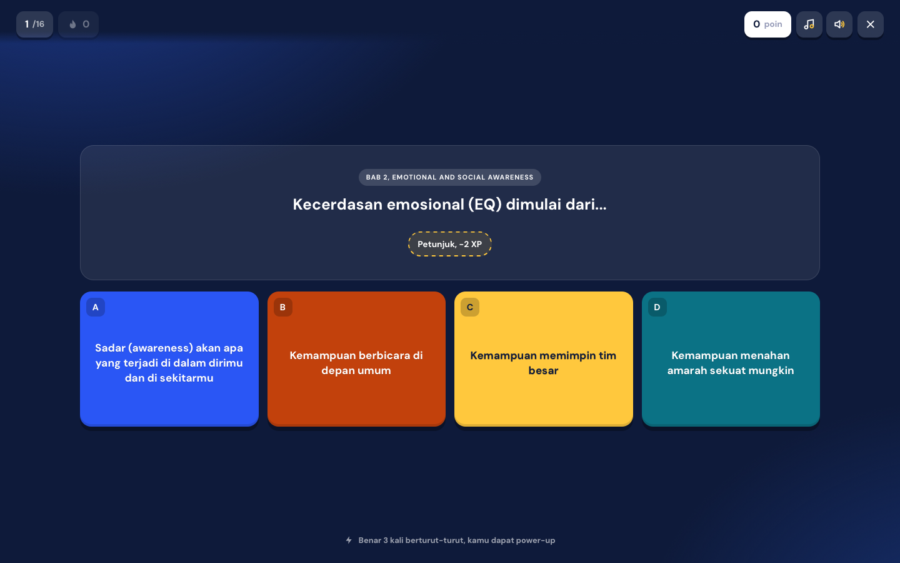

### 4. Simulasi kasus dunia kerja

Tiga simulasi bercabang menempatkan peserta pada situasi nyata: ditolak setelah wawancara, menerima kritik keras dari atasan saat magang, dan menghadapi tenggat proyek tim. Setiap pilihan membawa peserta ke situasi yang berbeda, dengan empat kemungkinan akhir cerita per kasus. Alur cerita menyesuaikan kinerja peserta. Setiap kasus dilengkapi dasar kasus nyata yang dapat ditelusuri (data BPS, Permenaker Nomor 6 Tahun 2020 tentang pemagangan, ketentuan lembur, dan riset PMI tentang *scope creep*).

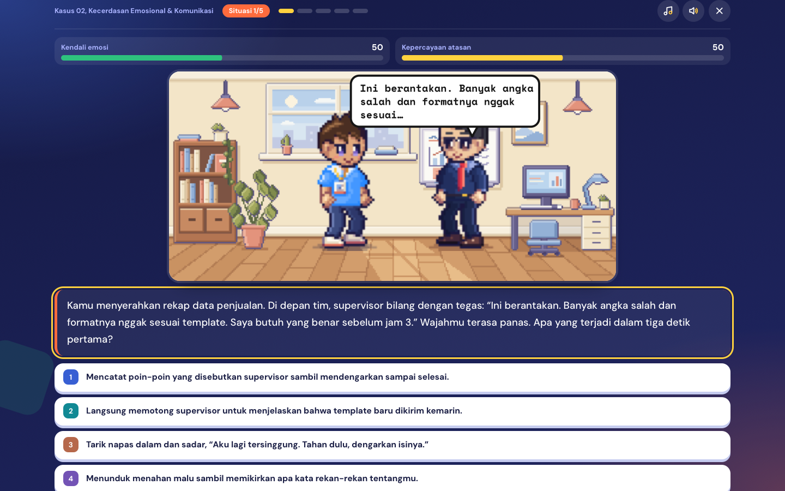

### 5. Penilaian

Nilai Akhir = (Nilai Pilihan Ganda × 30%) + (Nilai Simulasi × 70%).

Nilai pilihan ganda diambil dari skor terbaik kuis gabungan dengan batas lulus 70. Nilai simulasi merupakan gabungan berbobot tiga aspek (35%, 35%, 30%). Hasil akhir dikelompokkan ke dalam kategori kesiapan kerja dan ditampilkan setelah seluruh latihan selesai. Peserta dapat mencetak kartu hasil dan mengunduh sertifikat penyelesaian. Nilai ini merupakan umpan balik belajar mandiri, bukan sertifikasi resmi.

### 6. Gamifikasi

- XP diberikan berdasarkan penguasaan materi. Mengulang latihan hanya menambah XP apabila skor meningkat.
- Level karier: Pemula, Calon Kandidat, Siap Interview, dan Job Ready.
- 12 lencana kompetensi, target belajar mingguan, dan misi mingguan.
- Profil kesiapan kerja untuk tiga kelompok *soft skill*.
- Tidak terdapat papan peringkat, sehingga peserta hanya membandingkan progres dirinya sendiri.

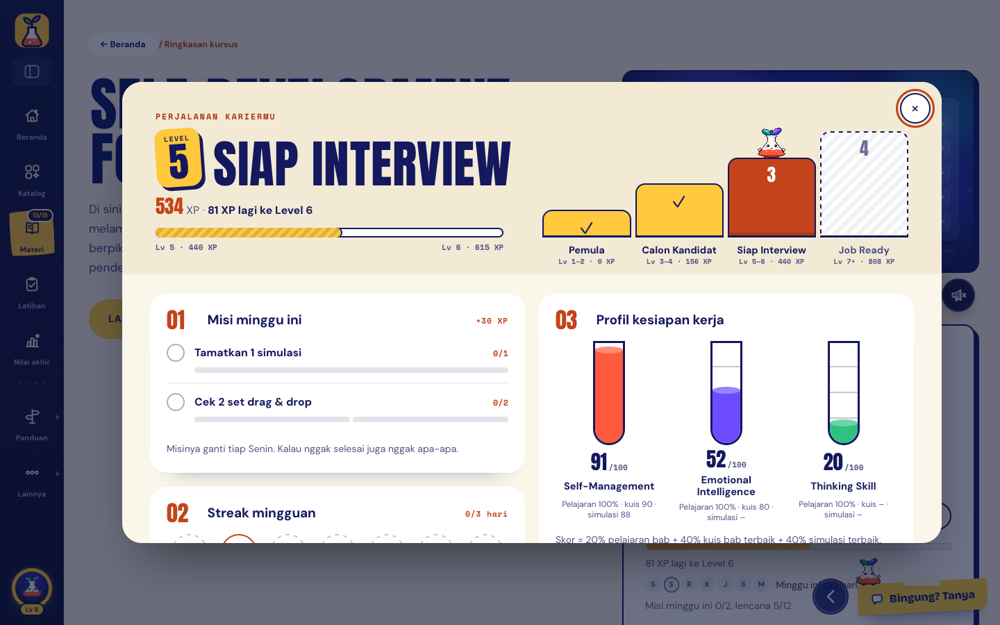

### 7. Panduan

Bagian panduan memuat petunjuk penggunaan, tujuan belajar, alur belajar, peta konsep, glosarium (87 istilah), referensi, pertanyaan yang sering diajukan, ide kegiatan belajar bersama, identitas pengembang, serta laporan pengembangan. Beberapa halaman panduan dilengkapi video penjelasan berdurasi 24 sampai 30 detik.

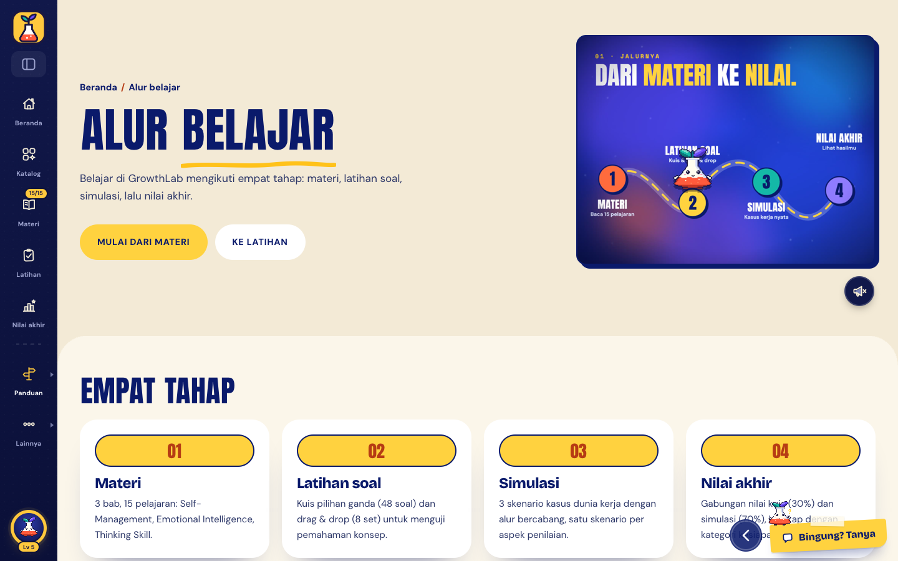

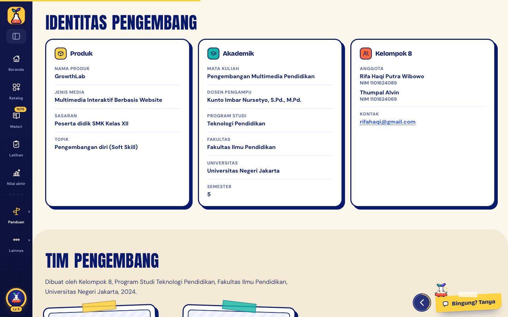

### 8. Laporan pengembangan

Halaman **Laporan pengembangan** di dalam produk merangkum proses pengembangan GrowthLab mengikuti model Hannafin dan Peck: analisis kebutuhan, desain, serta pengembangan dan implementasi, dengan evaluasi dan revisi di setiap tahap. Halaman ini memuat linimasa pengembangan, tabel masukan dosen beserta tindak lanjutnya, dan status uji ahli media serta uji coba pengguna.

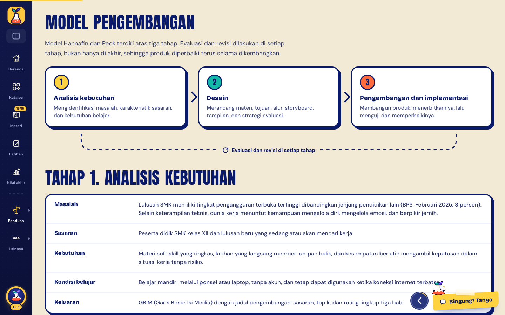

### 9. Asisten, pengaturan, dan aksesibilitas

- **Asisten "Bingung? Tanya"** menjawab pertanyaan berdasarkan materi dan FAQ GrowthLab tanpa layanan kecerdasan buatan dari pihak luar.
- **Maskot Labi** (labu Erlenmeyer bertunas) menemani peserta di beranda, layar pemuatan, asisten, dan saat pelajaran selesai.
- **Pengaturan** mencakup nama peserta, tema terang atau gelap, ukuran teks, kontras tinggi, pengurangan gerakan, volume, dan pengaturan ulang progres.
- Tampilan menyesuaikan ukuran layar ponsel, tablet, dan komputer.

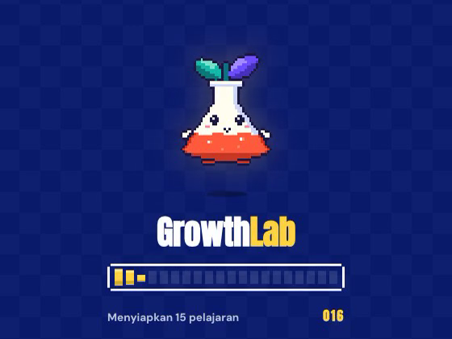 &nbsp; 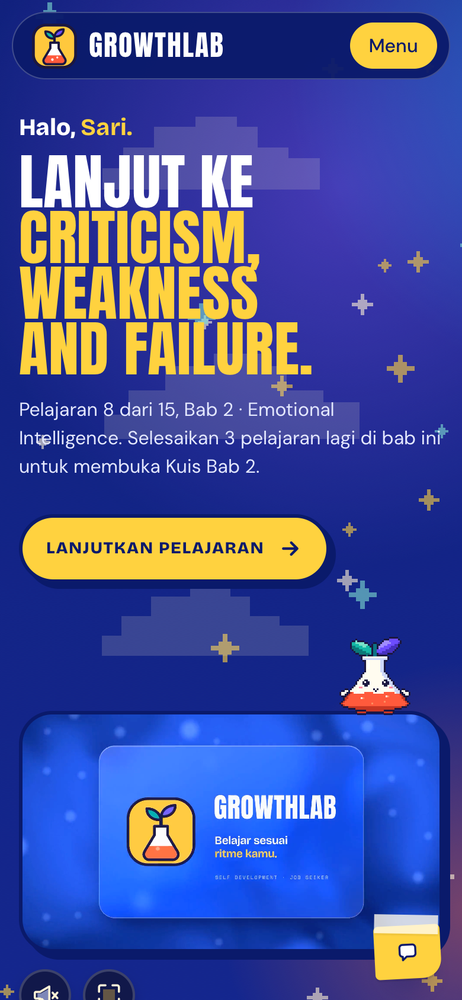

## Petunjuk Penggunaan

1. Buka **[akirasakamiyo.github.io/GrowthLab](https://akirasakamiyo.github.io/GrowthLab/)** melalui peramban (Chrome, Edge, atau Safari).
2. Pilih bab pada menu **Materi**, pelajari isi pelajaran, kerjakan uji pemahaman, lalu tekan **Tandai selesai**.
3. Setelah seluruh pelajaran pada satu bab selesai, kerjakan **Latihan** bab tersebut: kuis, *drag and drop*, dan simulasi.
4. Setelah seluruh latihan selesai, buka **Nilai akhir** untuk melihat hasil dan mengunduh sertifikat.

**Penggunaan tanpa internet.** GrowthLab dapat dipasang sebagai aplikasi (*Progressive Web App*). Pada Chrome atau Edge, buka **Pengaturan → Tentang GrowthLab → Pasang**. Pada iPhone atau iPad, buka melalui Safari, lalu pilih **Bagikan → Tambah ke Layar Utama**. Setelah dibuka sekali dengan koneksi internet, materi dan latihan dapat digunakan tanpa internet. Video tetap memerlukan koneksi internet.

## Spesifikasi Teknis

| Aspek | Keterangan |
|---|---|
| Teknologi | HTML, CSS, dan JavaScript tanpa proses *build*; pustaka GSAP dan Lenis disimpan di dalam repositori |
| Server | Tidak memerlukan server maupun akun; situs statis di GitHub Pages |
| Penyimpanan data | Progres dan nilai disimpan di peramban peserta (*localStorage*) dan dapat diunduh sebagai file cadangan |
| Mode luring | *Progressive Web App* dengan *service worker* |
| Pengujian | Pengujian otomatis dengan Playwright pada Chrome dan Safari (WebKit), di ukuran layar komputer dan ponsel |

**Versi produk.** Setiap tahap pengumpulan disimpan sebagai versi tersendiri agar perkembangan produk dapat dibandingkan:

| Versi | Alamat |
|---|---|
| Versi terbaru (menuju produk final, 9 Desember 2026) | https://akirasakamiyo.github.io/GrowthLab/ |
| Pertemuan 12 (24 November 2026) | https://akirasakamiyo.github.io/GrowthLab/versi/pertemuan-12/ |

**Repositori.** Kode sumber berada pada cabang [`kode`](https://github.com/akirasakamiyo/GrowthLab/tree/kode). Cabang `main` berisi versi situs yang ditayangkan. Versi yang dikumpulkan ditandai dengan *tag*, misalnya [`pertemuan-12`](https://github.com/akirasakamiyo/GrowthLab/tree/pertemuan-12).

> **Catatan.** GrowthLab merupakan prototipe untuk keperluan tugas mata kuliah. Karena seluruh data tersimpan di peramban, progres tidak berpindah antarperangkat kecuali melalui fitur unduh dan pulihkan cadangan.

---

Dikembangkan oleh <b>Kelompok 8</b> · Program Studi Teknologi Pendidikan · Fakultas Ilmu Pendidikan · Universitas Negeri Jakarta

