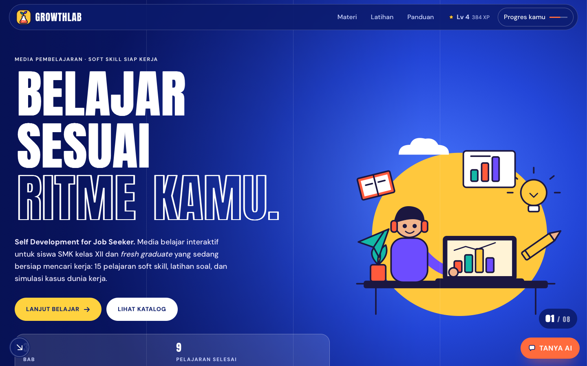
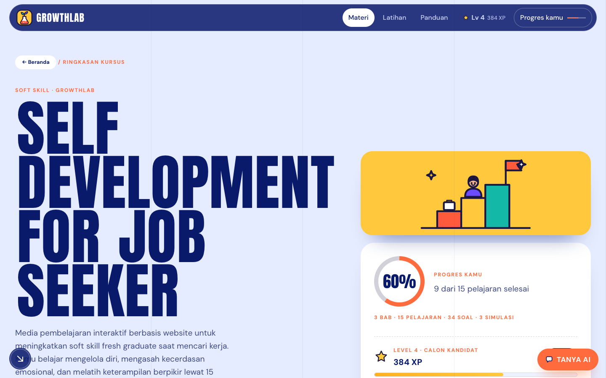
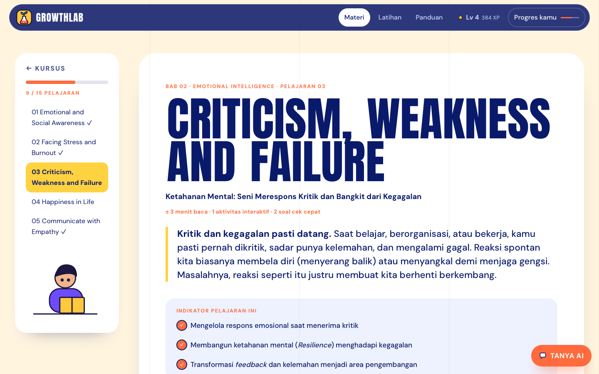
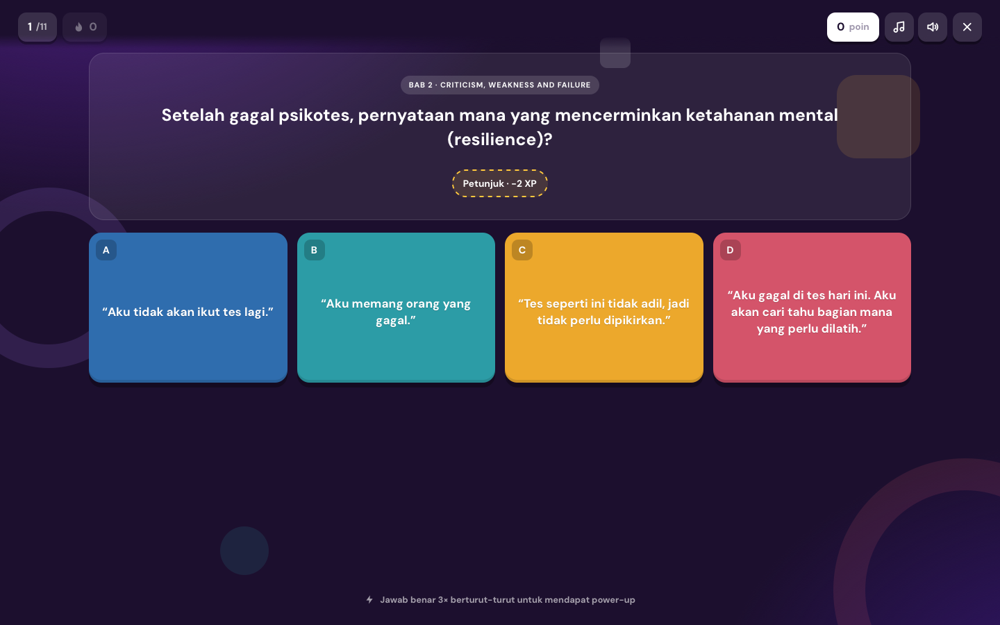
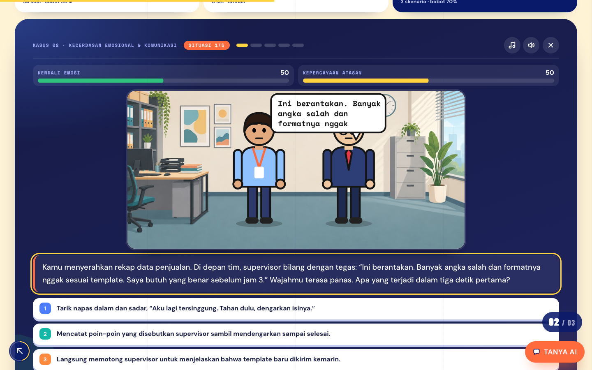
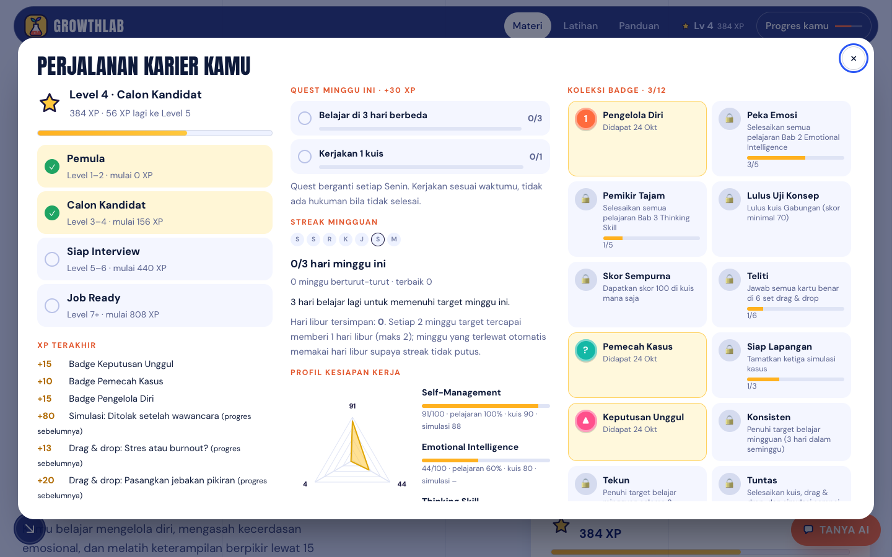
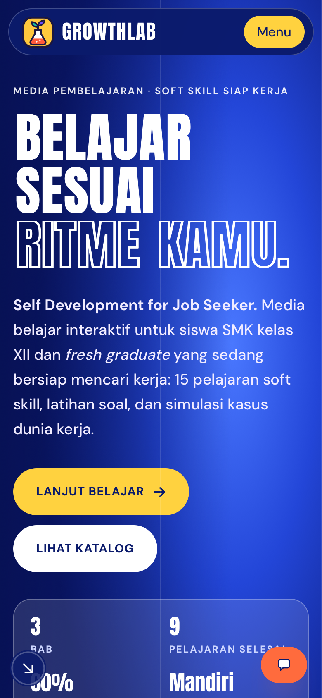

<div align="center">

# 🌱 GrowthLab

### Self Development for Job Seeker

Media pembelajaran interaktif berbasis website untuk mengembangkan **soft skill** siswa SMK kelas XII dan *fresh graduate* sebelum dan selama mencari kerja.

**[▶ Buka GrowthLab](https://akirasakamiyo.github.io/GrowthLab/)** · **[⬇ Unduh versi offline](https://akirasakamiyo.github.io/GrowthLab/offline/GrowthLab_offline.zip)** · **[⬇ Paket SCORM untuk LMS](https://akirasakamiyo.github.io/GrowthLab/offline/GrowthLab_SCORM12.zip)**

Kelompok 8 · Pengembangan Multimedia Pendidikan · Teknologi Pendidikan FIP Universitas Negeri Jakarta



</div>

## Tentang GrowthLab

Lulusan SMK punya tingkat pengangguran terbuka tertinggi dibanding jenjang pendidikan lain (BPS, Februari 2025: 8 persen). Selain keterampilan teknis, dunia kerja menuntut kemampuan mengelola diri, mengelola emosi, dan berpikir jernih. GrowthLab dirancang untuk melatih ketiganya lewat materi singkat, latihan interaktif, dan simulasi kasus dunia kerja yang bercabang.

Semua berjalan langsung di browser: **gratis, tanpa akun, tanpa server**, dan bisa dibuka **offline**.

## Isi pembelajaran

| Bab | Topik | Pelajaran |
|---|---|---|
| 1 | **Self-Management** | Recognise Your Strengths · Thoughts, Feelings, & What You Do · Change Your Thinking · Problem Solving · Keeping Well |
| 2 | **Emotional Intelligence** | Emotional and Social Awareness · Facing Stress and Burnout · Criticism, Weakness and Failure · Happiness in Life · Communicate with Empathy |
| 3 | **Thinking Skill** | System Thinking · Critical Thinking · Strategic Thinking · Reflective Thinking · Creative Thinking |

Setiap pelajaran berisi uraian, konsep penting, diagram, contoh kasus, aktivitas "Coba sendiri", dan cek pemahaman cepat.



## Fitur utama

**📚 Materi interaktif.** 15 pelajaran dalam 3 bab, lengkap dengan peta konsep dan glosarium.



**🎮 Latihan bergaya game.**
- Kuis pilihan ganda ala Quizizz (34 soal, per bab atau gabungan), dengan petunjuk bertahap di kuis per bab.
- 6 set drag & drop yang bisa dimainkan dengan mouse, sentuhan, atau keyboard.



**🧭 Simulasi kasus dunia kerja yang bercabang dan adaptif.**
- Ada 3 kasus: ditolak setelah wawancara, kritik keras dari atasan saat magang, dan tenggat proyek tim.
- Setiap pilihan membawa ke situasi berbeda, dengan 4 kemungkinan akhir cerita per kasus.
- Cerita menyesuaikan caramu bermain: kalau kamu kesulitan, ada tokoh yang membantu; kalau kamu sedang bagus, tantangannya naik.
- Setiap kasus disusun dari situasi nyata, dengan dasar kasus yang bisa dicek: data BPS, Permenaker 6/2020 tentang pemagangan, aturan lembur, dan riset PMI tentang *scope creep*.



**📊 Nilai akhir yang transparan.** Nilai Akhir = Pilihan Ganda × 30% + Simulasi × 70%. Nilai terbuka setelah semua latihan selesai, lalu bisa dicetak sebagai kartu hasil.

**🏆 Gamifikasi yang sehat (bisa dimatikan).**
- **XP:** didapat dari penguasaan materi, bukan sekadar klik. Mengulang latihan hanya menambah XP kalau skornya naik.
- **Level karier:** Pemula → Calon Kandidat → Siap Interview → Job Ready.
- **Badge dan target:** 12 badge kompetensi, streak mingguan yang ramah (3 hari per minggu, ada jatah hari libur), dan quest mingguan.
- **Profil kesiapan kerja:** radar 3 soft skill dan sertifikat penyelesaian (PNG).
- **Tanpa leaderboard:** semua elemen bisa dimatikan dengan satu tombol.



**💾 Data milik pengguna.** Progres tersimpan di browser dan bisa diunduh atau dipulihkan sebagai file cadangan. Catatan aktivitas belajar bisa diekspor (JSON/CSV) untuk keperluan penelitian. Tidak ada data yang dikirim ke pihak lain.

**📱 Nyaman di semua perangkat.** Tampilan menyesuaikan HP, tablet, dan laptop/PC.

<p align="center"></p>

## Cara memakai

1. Buka **[akirasakamiyo.github.io/GrowthLab](https://akirasakamiyo.github.io/GrowthLab/)**.
2. Pilih bab di menu **Materi**, baca pelajaran, lalu tekan **Tandai selesai**.
3. Kerjakan **Latihan**: kuis, drag & drop, dan simulasi.
4. Lihat **Nilai akhir** dan unduh sertifikatmu.

**Tanpa internet:** unduh [GrowthLab_offline.zip](https://akirasakamiyo.github.io/GrowthLab/offline/GrowthLab_offline.zip), ekstrak, lalu buka `index.html`.
**Untuk LMS (Moodle, dll.):** unggah [GrowthLab_SCORM12.zip](https://akirasakamiyo.github.io/GrowthLab/offline/GrowthLab_SCORM12.zip) sebagai paket SCORM 1.2. Nilai akhir otomatis dilaporkan ke LMS.

## Teknologi

HTML, CSS, dan JavaScript murni (tanpa *build step*), dengan pustaka lokal GSAP, Lenis, Matter.js, dan three.js. Semua aset ada di repo ini, jadi situs berjalan tanpa CDN maupun server.

```
index.html     kerangka halaman
css/           gaya (01–14), dimuat berurutan
js/            skrip (01–21) + js/gamifikasi/ (XP, badge, streak, quest, cadangan, log)
vendor/        pustaka & font lokal
assets/        gambar simulasi & storyboard
offline/       paket ZIP dan SCORM siap unduh
```

Isi materi, kuis, drag & drop, dan simulasi ada di satu file: `js/03-data.js`.

> **Catatan:** ini prototipe tugas kuliah. Karena semua data tersimpan di browser, skor dan XP bisa diubah lewat devtools. Logika gamifikasi sengaja dipisah di `js/gamifikasi/` agar mudah dipindah ke server di kemudian hari.

---

<div align="center">
Dibuat oleh <b>Kelompok 8</b> · Teknologi Pendidikan FIP Universitas Negeri Jakarta
</div>
