# Storyboard dan Skenario Pembelajaran GrowthLab

**Produk:** GrowthLab, *Self Development for Job Seeker*
**Jenis media:** multimedia interaktif berbasis website (bisa dibuka daring, paket offline, dan SCORM 1.2)
**Sasaran:** peserta didik SMK kelas XII dan *fresh graduate*
**Pengembang:** Kelompok 8, Teknologi Pendidikan FIP UNJ (Rifa Haqi Putra Wibowo, Thumpal Alvin)
**Dosen pengampu:** Kunto Imbar Nursetyo, S.Pd., M.Pd.
**Semester:** 5
**Situs:** https://akirasakamiyo.github.io/GrowthLab/

Dokumen ini berisi skenario pembelajaran (alur belajar yang dialami peserta dari awal sampai akhir) dan storyboard per
layar. Gambar layar diambil langsung dari produk yang sudah jadi, ada di folder `docs/storyboard/`.

---

## 1. Tujuan pembelajaran

**Tujuan umum.** Peserta didik SMK kelas XII dan *fresh graduate* mampu mengembangkan diri (*soft skill*) melalui
pengelolaan diri, kecerdasan emosional, dan keterampilan berpikir, sehingga lebih siap menghadapi proses rekrutmen dan
dunia kerja.

**Tujuan khusus.** Ada 15 tujuan, satu untuk setiap pelajaran, ditulis dengan format ABCD:

| Unsur | Arti | Di GrowthLab |
|---|---|---|
| A, *Audience* | siapa yang belajar | peserta didik |
| B, *Behavior* | perilaku yang bisa diamati | misalnya memetakan kekuatan diri dengan metode S.I.G.N |
| C, *Condition* | kondisi saat perilaku ditunjukkan | setelah mempelajari materi dan mengerjakan aktivitas tertentu |
| D, *Degree* | kriteria keberhasilan | misalnya minimal 70% jawaban drag & drop benar |

Daftar lengkap 15 tujuan dan tabel kesesuaian tujuan, materi, dan evaluasi ada di halaman **Panduan, Tujuan belajar**
(layar 13). Angka di tabel itu dihitung langsung dari bank soal, jadi selalu sesuai isi produk.

---

## 2. Isi media

| Bab | Pelajaran |
|---|---|
| 1. Self-Management | Recognise Your Strengths · Thoughts, Feelings, & What You Do · Change Your Thinking · Problem Solving · Keeping Well |
| 2. Emotional Intelligence | Emotional and Social Awareness · Facing Stress and Burnout · Criticism, Weakness and Failure · Happiness in Life · Communicate with Empathy |
| 3. Thinking Skill | System Thinking · Critical Thinking · Strategic Thinking · Reflective Thinking · Creative Thinking |

Evaluasi: 48 soal kuis pilihan ganda, 90 pernyataan cek cepat (benar/salah), uji pemahaman di setiap pelajaran,
8 set drag & drop, dan 3 kasus simulasi dunia kerja yang bercabang. Pendukung: glosarium 87 istilah, 15 referensi,
peta konsep, asisten chat "Bingung? Tanya", dan gamifikasi (level, XP, lencana, misi mingguan).

---

## 3. Skenario pembelajaran

Skenario disusun mengikuti tiga tahap kegiatan belajar (pendahuluan, inti, penutup) dan sembilan peristiwa belajar
Gagné. Kolom "Layar" merujuk nomor storyboard di bagian 5.

### 3.1 Pendahuluan

| Langkah | Yang dilakukan peserta | Yang dilakukan media | Peristiwa belajar | Layar |
|---|---|---|---|---|
| 1 | Membuka GrowthLab | Menampilkan beranda: judul "Kenali diri, baru lamar kerja", video promo, Labi menyapa | Menarik perhatian | 01 |
| 2 | Membaca Petunjuk dan menonton video cara pakai 1 menit | Menjelaskan empat langkah belajar, arti ikon, dan cara menyimpan progres | Menarik perhatian | 12 |
| 3 | Membaca Tujuan belajar | Menampilkan tujuan umum dan 15 tujuan ABCD | Menyampaikan tujuan | 13 |
| 4 | Melihat Alur belajar dan Peta konsep | Menunjukkan empat tahap (materi, latihan, simulasi, nilai) dan hubungan semua konsep | Mengingatkan prasyarat, memberi gambaran utuh | 14, 15 |
| 5 | Membuka Ringkasan kursus | Menampilkan 3 bab, progres 0/15, dan level awal | Menyampaikan tujuan | 02 |

### 3.2 Inti, diulang untuk setiap pelajaran (15 kali)

| Langkah | Yang dilakukan peserta | Yang dilakukan media | Peristiwa belajar | Layar |
|---|---|---|---|---|
| 6 | Membaca pengantar dan materi sampai habis | Menampilkan pengantar, 3 sampai 4 bagian materi, diagram, konsep kunci, contoh kasus dari dunia kerja lulusan SMK, lalu Poin utama | Menyajikan materi | 03 |
| 7 | Mengerjakan aktivitas Coba sendiri | Menyediakan 1 sampai 3 aktivitas interaktif (misalnya Uji kekuatanmu dengan S.I.G.N, Tangga 5 Whys, Roda emosi) dengan umpan balik langsung | Memberi bimbingan, memancing unjuk kerja | 04 |
| 8 | Menjawab Uji pemahaman | Memberi soal studi kasus dan menjelaskan alasan jawaban yang benar maupun yang keliru | Memancing unjuk kerja, memberi umpan balik | 05 |
| 9 | Menjawab Cek cepat (benar/salah) | Mengecek pemahaman inti pelajaran dan langsung memberi tahu benar atau salah | Memberi umpan balik | 05 |
| 10 | Menulis Catatan pribadi (boleh dilewati) | Menyimpan catatan otomatis di browser | Membantu retensi | 06 |
| 11 | Menekan Tandai selesai | Mencatat progres, menambah XP, membuka pelajaran berikutnya; bila peserta lama diam, Labi menunjuk langkah yang belum dikerjakan | Memperkuat retensi | 06 |

Aturan urutan: materi selalu tampil utuh lebih dulu, aktivitas baru muncul setelah bagian terakhir. Pelajaran
berikutnya terbuka setelah pelajaran sebelumnya ditandai selesai.

### 3.3 Latihan dan evaluasi

| Langkah | Yang dilakukan peserta | Yang dilakukan media | Peristiwa belajar | Layar |
|---|---|---|---|---|
| 12 | Membuka Latihan sebelum babnya selesai | Menampilkan kunci dan berapa pelajaran lagi yang perlu diselesaikan, dengan tombol Lanjut belajar | Mengarahkan urutan belajar | 07 |
| 13 | Mengerjakan kuis bab sebagai pemanasan | Kuis per bab terbuka setelah 5 pelajaran bab itu selesai, tidak masuk nilai | Memancing unjuk kerja | 08 |
| 14 | Mengerjakan drag & drop | 8 set (memasangkan, mengurutkan, mengelompokkan), terbuka per bab, tidak masuk nilai | Memancing unjuk kerja, umpan balik | 09 |
| 15 | Mengerjakan kuis Gabungan | Terbuka setelah 15 pelajaran selesai; soal dan pilihan diacak; batas lulus 70; masuk nilai 30% | Menilai unjuk kerja | 08 |
| 16 | Mengerjakan 3 kasus simulasi | Kasus 1 terbuka setelah Bab 1, Kasus 2 setelah Bab 2, Kasus 3 setelah Bab 3. Tiap kasus 5 situasi; setiap pilihan mengubah jalan cerita dan meteran; masuk nilai 70% | Menilai unjuk kerja, transfer ke situasi nyata | 10 |

### 3.4 Penutup

| Langkah | Yang dilakukan peserta | Yang dilakukan media | Peristiwa belajar | Layar |
|---|---|---|---|---|
| 17 | Melihat Nilai akhir | Menghitung Nilai akhir = (Pilihan ganda × 0,30) + (Simulasi × 0,70), menunjukkan kategori kesiapan kerja dan rincian tiga aspek | Menilai unjuk kerja | 11 |
| 18 | Mencetak kartu hasil (boleh) | Membuat kartu umpan balik dengan nama peserta dan tempat tanda tangan guru/fasilitator | Memperkuat retensi | 11 |
| 19 | Mengulang bagian yang lemah | Riwayat percobaan dan rincian aspek menunjukkan bagian yang perlu diulang | Transfer dan retensi | 11 |

**Kategori kesiapan kerja:** 86–100 Sangat Siap Kerja, 71–85 Siap Kerja, 56–70 Cukup Siap / Perlu Latihan Lanjutan,
di bawah 56 Belum Siap Kerja. Jika nilai pilihan ganda di bawah 70, kategori paling tinggi adalah Cukup Siap.

**Bobot aspek simulasi:** Self-Management & Resiliensi 35%, Kecerdasan Emosional & Komunikasi 35%, Thinking Skill &
Pemecahan Masalah 30%.

---

## 4. Peta navigasi

```
Beranda (01)
 ├─ Ringkasan kursus (02)
 │   └─ Bab 1 → Pelajaran 1.1 → 1.2 → 1.3 → 1.4 → 1.5 ─┐  (terbuka berurutan)
 │      Bab 2 → Pelajaran 2.1 … 2.5 ───────────────────┤
 │      Bab 3 → Pelajaran 3.1 … 3.5 ───────────────────┤
 │         tiap pelajaran: materi (03) → Coba sendiri (04) → Uji pemahaman dan Cek cepat (05) → Tandai selesai (06)
 ├─ Latihan (07)
 │   ├─ Kuis (08): per bab terbuka per bab, Gabungan terbuka setelah 15 pelajaran
 │   ├─ Drag & drop (09): terbuka per bab
 │   ├─ Simulasi (10): Kasus n terbuka setelah Bab n
 │   └─ Nilai akhir (11): muncul setelah kuis Gabungan, semua drag & drop, dan 3 simulasi selesai
 ├─ Panduan: Petunjuk (12), Tujuan belajar (13), Alur belajar (14), Peta konsep (15), Glosarium, Referensi, FAQ, Identitas tim (16)
 └─ Lainnya: Belajar bareng (ide kegiatan kelompok)

Selalu tersedia di setiap layar: sidebar menu, tombol Kembali, asisten "Bingung? Tanya", Perjalanan karier (level dan lencana).
```

---

## 5. Storyboard per layar

Setiap layar memakai tata letak yang sama: sidebar navigasi di kiri (di HP menjadi menu laci), isi di tengah, tombol
"Bingung? Tanya" dan tombol Kembali di kanan bawah. Palet: biru tua, biru, kuning, krem; huruf judul Anton, isi DM Sans;
maskot Labi bergaya pixel.

### 01. Beranda
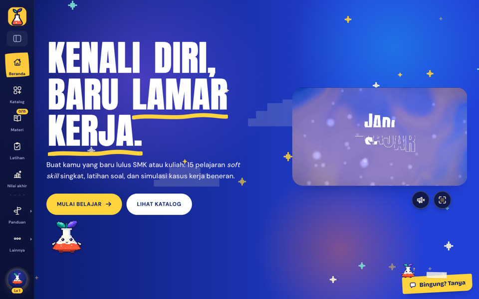

| Unsur | Isi |
|---|---|
| Visual | Judul besar "Kenali diri, baru lamar kerja", latar biru beranimasi (bintang dan awan pixel), video promo di kanan, Labi |
| Teks | "Buat kamu yang baru lulus SMK atau kuliah: 15 pelajaran soft skill singkat, latihan soal, dan simulasi kasus kerja beneran." |
| Audio | Video promo dengan musik; awalnya tanpa suara, dinyalakan lewat tombol suara |
| Interaksi | Mulai belajar (ke Ringkasan kursus), Lihat katalog, tombol suara, tombol layar penuh |

### 02. Ringkasan kursus
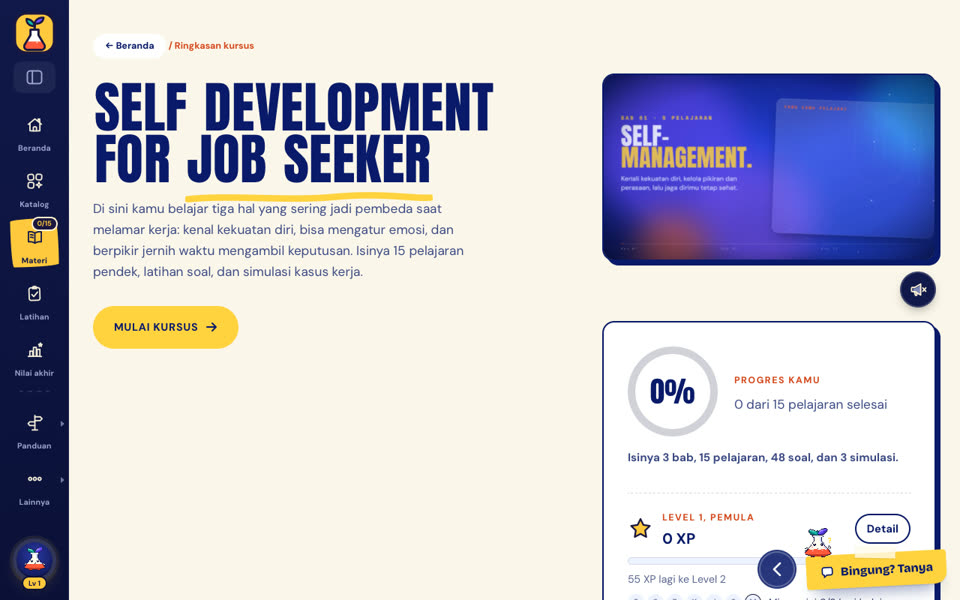

| Unsur | Isi |
|---|---|
| Visual | Judul kursus, video 30 detik pengenalan materi, kartu progres (persen, level, XP, misi mingguan) |
| Teks | Deskripsi kursus dan isi: 3 bab, 15 pelajaran, 48 soal, 3 simulasi |
| Audio | Video pengenalan dengan musik (tombol suara) |
| Interaksi | Mulai kursus, buka daftar pelajaran per bab, Detail level |
| Aturan | Bab berikutnya terbuka setelah bab sebelumnya selesai |

### 03. Pelajaran: materi
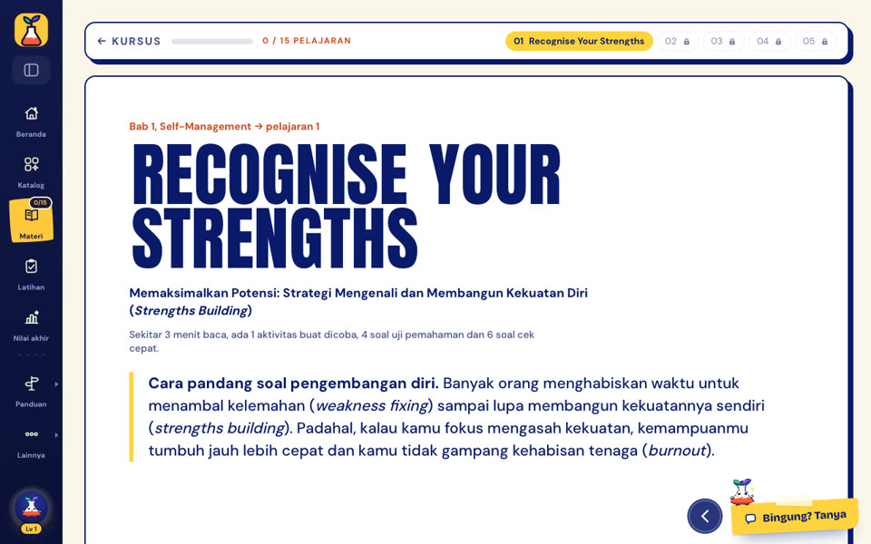

| Unsur | Isi |
|---|---|
| Visual | Bar daftar pelajaran di atas, judul pelajaran, ilustrasi pixel, diagram konsep, kotak konsep kunci dan contoh kasus |
| Teks | Pengantar, 3 sampai 4 bagian materi, contoh kasus lulusan SMK, Poin utama |
| Audio | Tidak ada |
| Interaksi | Gulir membaca, pindah pelajaran lewat bar atas, istilah asing terhubung ke Glosarium |

### 04. Pelajaran: Coba sendiri
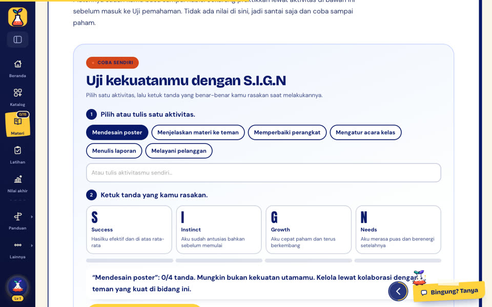

| Unsur | Isi |
|---|---|
| Visual | Kartu aktivitas berlabel "Coba sendiri" setelah materi selesai |
| Teks | Instruksi singkat dan umpan balik per pilihan |
| Interaksi | Mengisi, memilih, menyeret, atau menekan tombol; hasil langsung tampil |

### 05. Pelajaran: Uji pemahaman dan Cek cepat
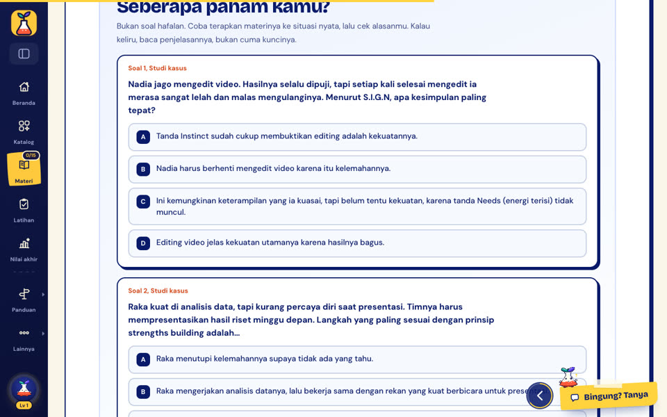

| Unsur | Isi |
|---|---|
| Visual | Soal studi kasus dengan pilihan A sampai D, lalu daftar pernyataan benar/salah |
| Teks | Penjelasan alasan setiap jawaban |
| Interaksi | Memilih jawaban; umpan balik langsung; tidak masuk nilai |

### 06. Pelajaran: Tandai selesai
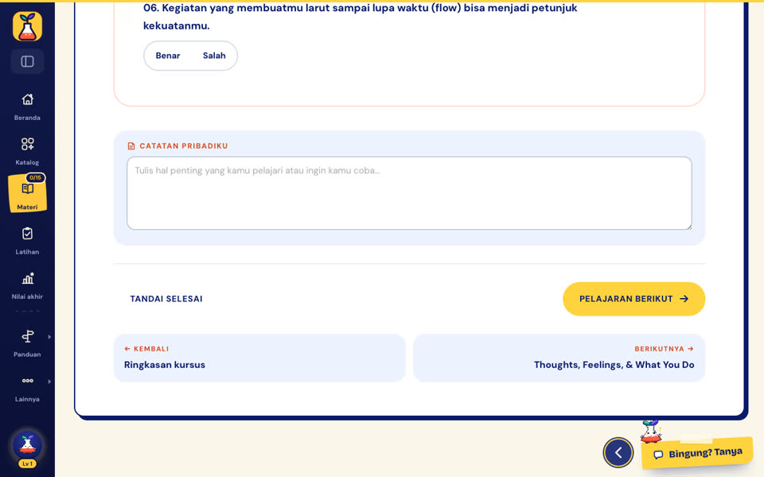

| Unsur | Isi |
|---|---|
| Visual | Kotak catatan pribadi, tombol Tandai selesai, tautan Pelajaran berikutnya |
| Interaksi | Tandai selesai menambah XP dan membuka pelajaran berikutnya; Labi muncul memberi petunjuk bila ada langkah yang terlewat |

### 07. Latihan: terkunci
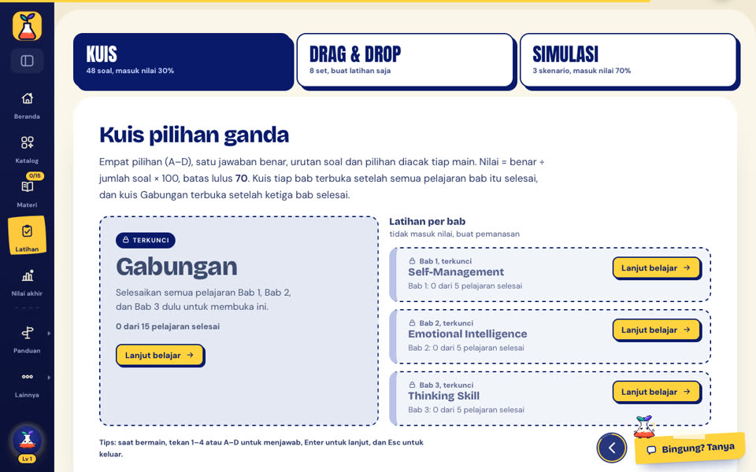

| Unsur | Isi |
|---|---|
| Visual | Tab Kuis, Drag & drop, Simulasi; kartu bergaris putus-putus dengan ikon gembok |
| Teks | "Selesaikan semua pelajaran Bab 1, Bab 2, dan Bab 3 dulu untuk membuka ini." dan jumlah pelajaran yang sudah selesai |
| Interaksi | Lanjut belajar (menuju pelajaran yang belum selesai) |

### 08. Latihan: kuis
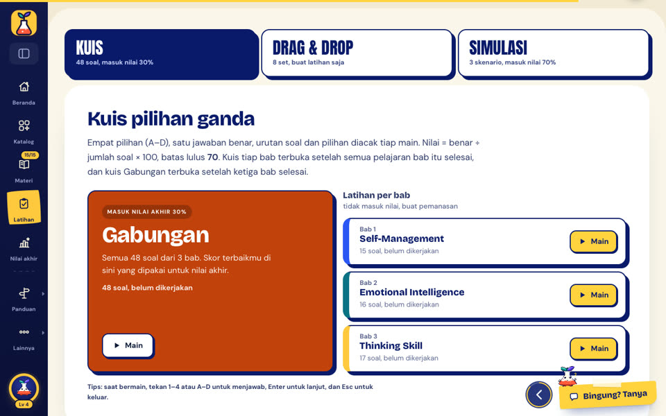

| Unsur | Isi |
|---|---|
| Visual | Kartu kuis Gabungan (masuk nilai 30%) dan tiga kuis per bab |
| Teks | Aturan: 4 pilihan, satu jawaban benar, diacak, batas lulus 70 |
| Audio | Efek suara saat memilih, beruntun, dan waktu habis; musik bisa dinyalakan atau dimatikan |
| Interaksi | Main; jawab dengan klik atau tombol 1–4/A–D; Enter lanjut; Esc keluar |

### 09. Latihan: drag & drop
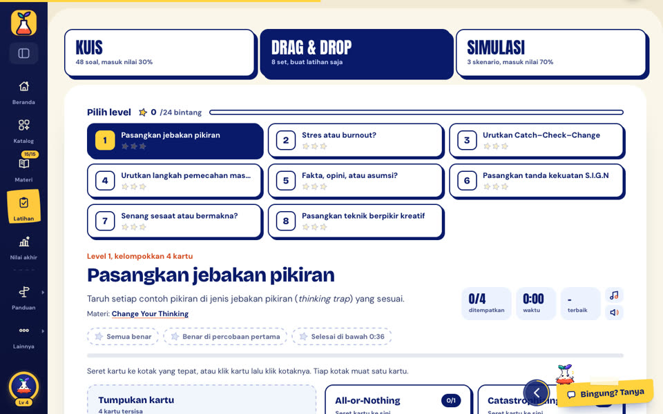

| Unsur | Isi |
|---|---|
| Visual | 8 level, papan kartu dan kotak tujuan, bintang per level |
| Interaksi | Menyeret kartu dengan mouse, sentuhan, atau keyboard; Periksa; ulangi untuk bintang lebih banyak |

### 10. Latihan: simulasi
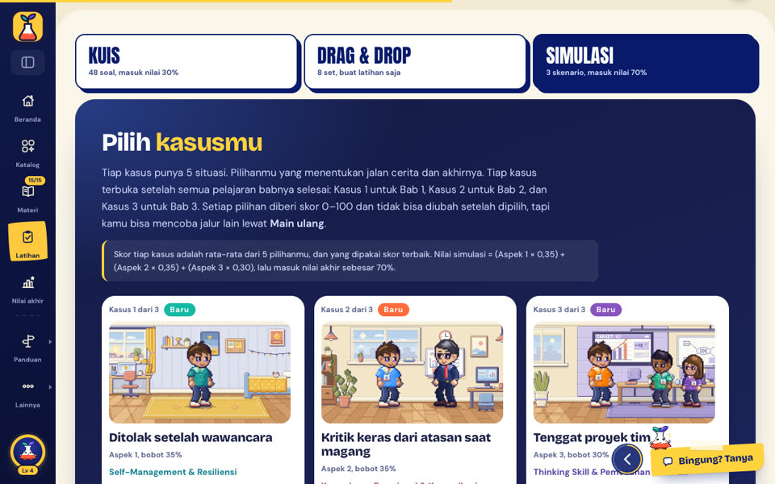

| Unsur | Isi |
|---|---|
| Visual | Tiga berkas kasus; panggung pixel dengan tokoh, balon dialog, dan meteran (misalnya Ketenangan, Daya juang) |
| Teks | Kasus 1 Ditolak setelah wawancara, Kasus 2 Kritik keras dari atasan saat magang, Kasus 3 Tenggat proyek tim; 5 situasi per kasus |
| Audio | Efek suara pilihan dan akhir cerita |
| Interaksi | Memilih respons; cerita bercabang ke beberapa akhir; skor terbaik dipakai |

### 11. Nilai akhir
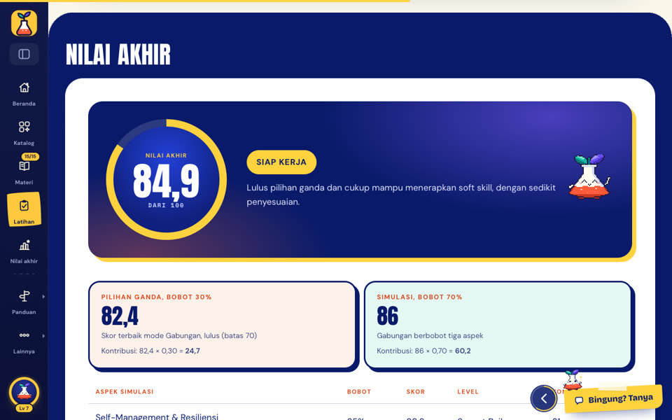

| Unsur | Isi |
|---|---|
| Visual | Cincin skor, lencana kategori, Labi, kartu komponen, batang skor per aspek, persamaan, meteran kategori |
| Teks | Rumus Nilai akhir dan arti kategori |
| Interaksi | Isi nama, Cetak kartu hasil, buka riwayat percobaan, hapus semua hasil latihan |

### 12. Panduan: Petunjuk
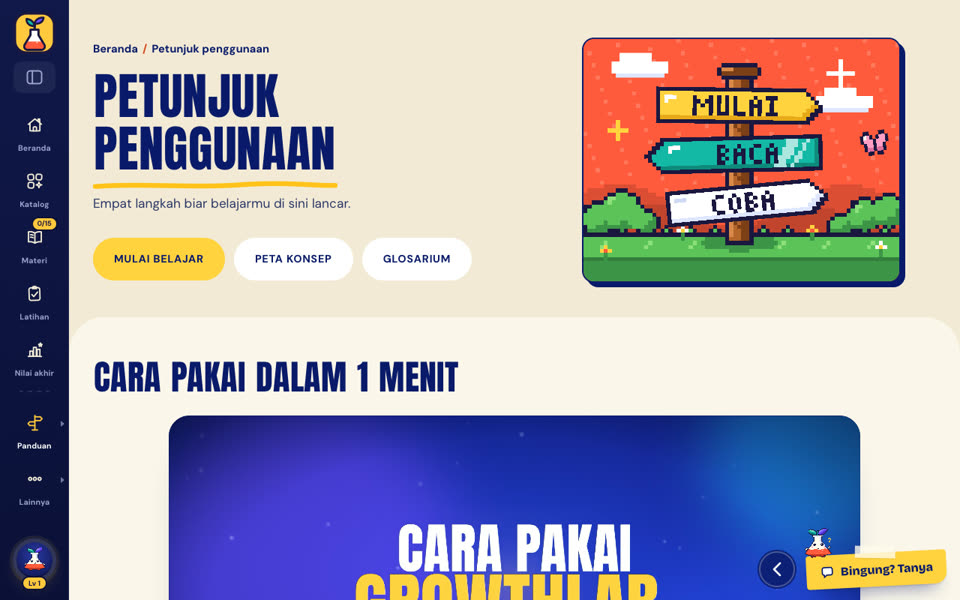

| Unsur | Isi |
|---|---|
| Visual | Video tutorial 1 menit, daftar langkah, arti ikon dan tombol |
| Audio | Video tutorial dengan musik latar (tombol suara) |
| Interaksi | Baca versi teks video, Mulai belajar |

### 13. Panduan: Tujuan belajar
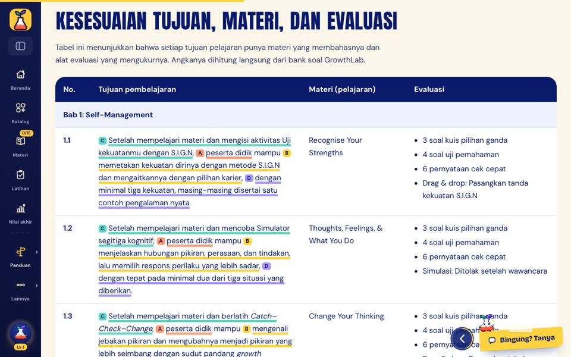

| Unsur | Isi |
|---|---|
| Visual | Video 30 detik tentang tujuan ABCD; tujuan per bab berwarna menurut unsur A, B, C, D; tabel kesesuaian |
| Interaksi | Tautan ke setiap pelajaran dan ke latihan yang mengukurnya |

### 14. Panduan: Alur belajar
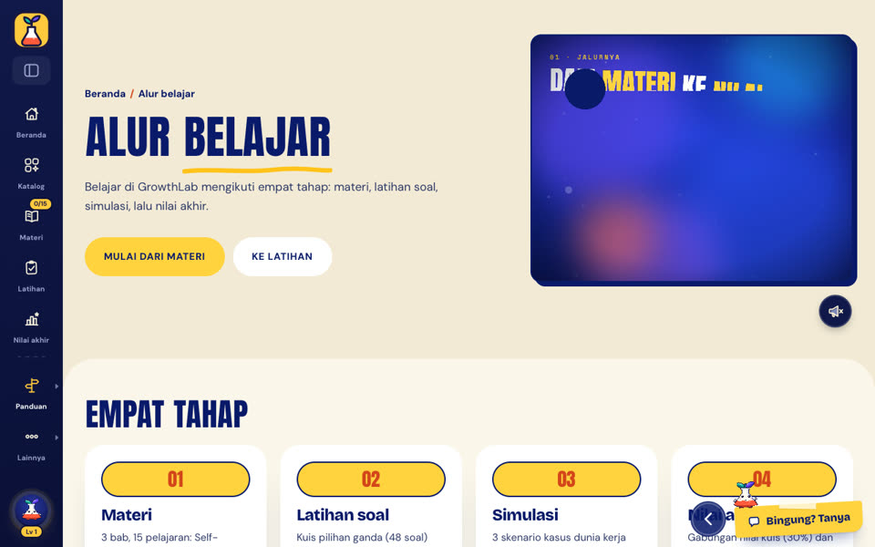

| Unsur | Isi |
|---|---|
| Visual | Video 30 detik empat tahap; kartu Materi, Latihan soal, Simulasi, Nilai akhir; rubrik tiga aspek |
| Interaksi | Mulai dari materi, Ke Latihan |

### 15. Panduan: Peta konsep
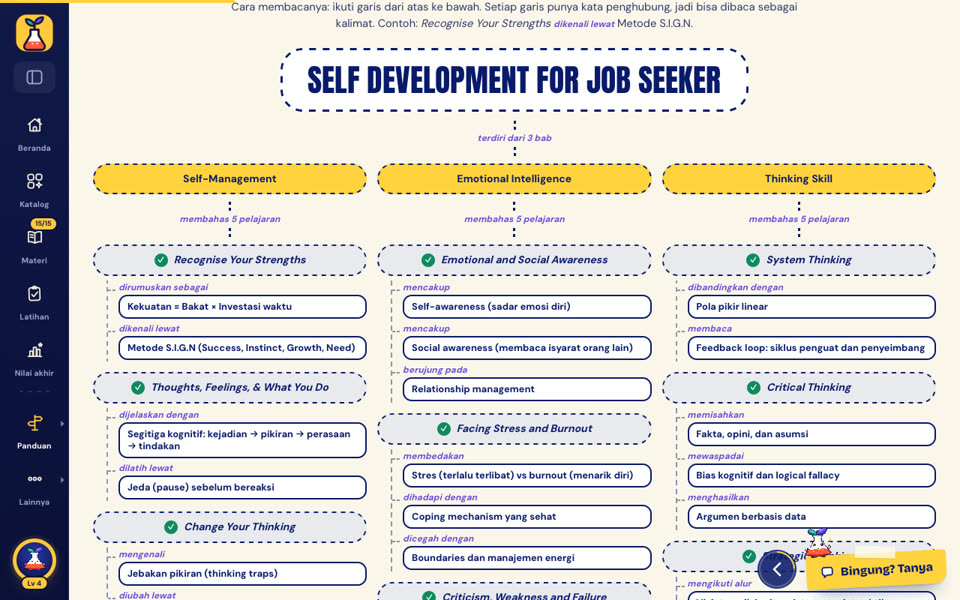

| Unsur | Isi |
|---|---|
| Visual | Akar kursus, 3 bab, 15 pelajaran, 2 sampai 3 konsep kunci per pelajaran dengan kata penghubung, dan hubungan antarbab; centang pada pelajaran yang selesai |
| Interaksi | Klik kotak untuk membuka pelajaran |

### 16. Panduan: Tentang dan identitas pengembang
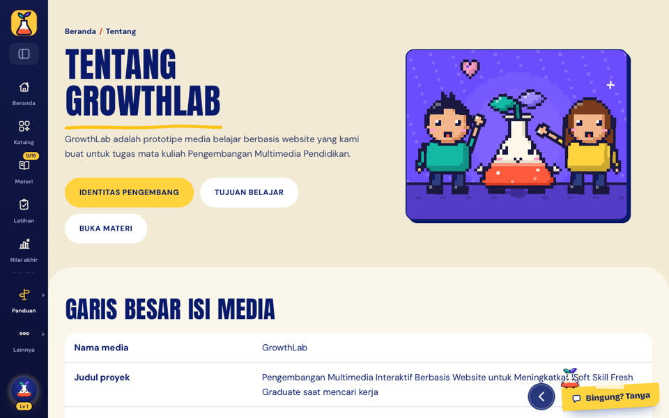

| Unsur | Isi |
|---|---|
| Visual | Garis besar isi media dan tabel identitas pengembang |
| Teks | Nama produk, jenis media, sasaran, mata kuliah, program studi, kelompok, tim pengembang, dosen pengampu, semester, kontak |

---

## 6. Catatan untuk pengembang

- Gambar storyboard dibuat ulang dengan `node` dan Playwright dari produk yang berjalan (lihat riwayat git), jadi selalu
  bisa diperbarui bila tampilan berubah.
